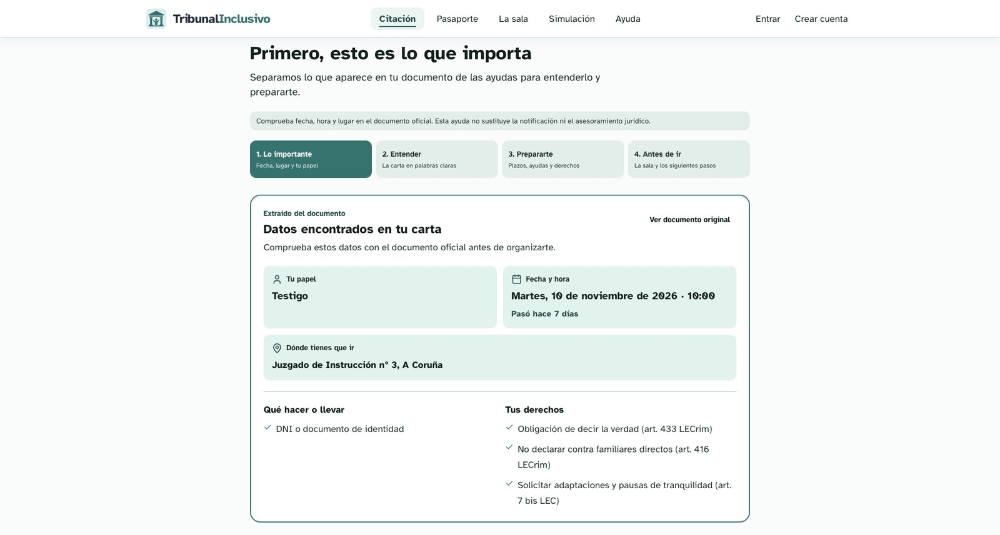
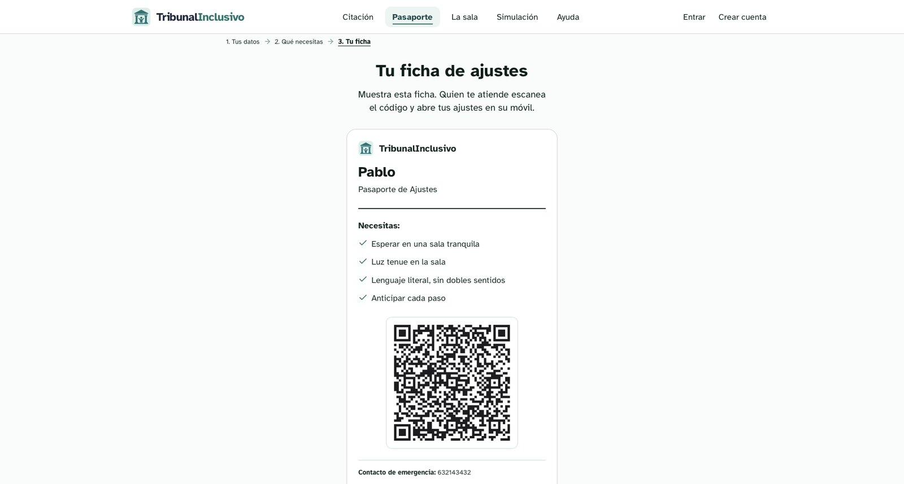
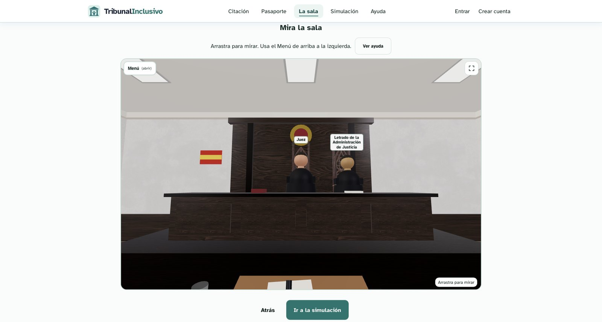
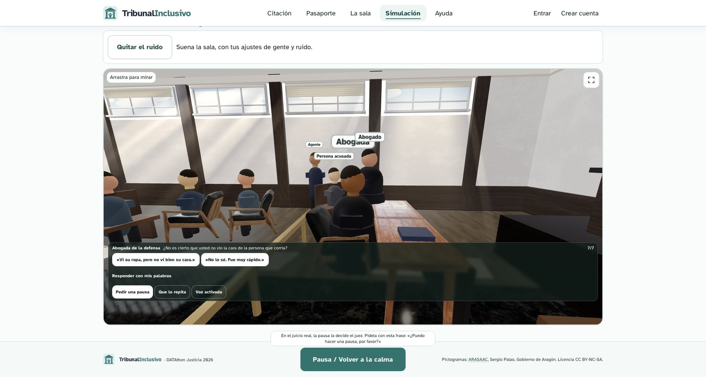
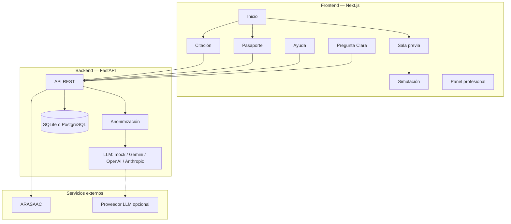

<p align="center">
  
</p>

<h1 align="center">TribunalInclusivo</h1>

<p align="center">
  <strong>De la citación a la sentencia, a tu manera.</strong><br>
  Accesibilidad cognitiva para entender el juzgado, pedir ajustes y ensayar la declaración antes del día.
</p>

<p align="center">
  
  
  
  
</p>

<p align="center">
  <a href="#-sobre-el-proyecto">Sobre el proyecto</a> •
  <a href="#-demo">Demo</a> •
  <a href="#-capturas">Capturas</a> •
  <a href="#-funcionalidades">Funcionalidades</a> •
  <a href="#-tecnologías">Tecnologías</a> •
  <a href="#-arquitectura">Arquitectura</a> •
  <a href="#-estructura-del-repositorio">Estructura</a> •
  <a href="#-puesta-en-marcha">Puesta en marcha</a>
</p>

---

## 📌 Sobre el proyecto

**TribunalInclusivo** es una aplicación web de accesibilidad cognitiva para la justicia española, desarrollada en el **DATAthon Justicia 2026** (A Coruña, Reto 3: *Justicia inteligente para la neurodiversidad*).

Ayuda a personas con autismo, TDAH, dislexia, discalculia u otras necesidades de apoyo a entender una citación o una sentencia, pedir adaptaciones sin revelar un diagnóstico y familiarizarse con la sala de vistas antes del día del juicio. Se puede practicar sin registrarse; una cuenta sirve para guardar el progreso.

### 🎯 Objetivos

- Traducir documentos judiciales a lenguaje claro, lectura fácil y apoyos visuales, sin sustituir la notificación oficial ni el asesoramiento jurídico.
- Generar un Pasaporte de Ajustes (código QR) con las adaptaciones que la persona necesita, amparado en el art. 7 bis de la LEC y en la Guía del CGPJ (2025).
- Permitir recorrer la sala en 3D y ensayar la declaración, con pausas y control del ambiente, antes de ir al juzgado.

## 🎥 Demo


https://github.com/user-attachments/assets/d0fecd39-cd16-4d75-bdb8-55878f646ce6


## 📸 Capturas

<table>
  <tr>
    <td align="center" width="50%">
      <br>
      <sub>Datos extraídos de la citación</sub>
    </td>
    <td align="center" width="50%">
      <br>
      <sub>Pasaporte de Ajustes con código QR</sub>
    </td>
  </tr>
  <tr>
    <td align="center" width="50%">
      <br>
      <sub>Recorrido 3D de la sala de vistas</sub>
    </td>
    <td align="center" width="50%">
      <br>
      <sub>Simulación del juicio</sub>
    </td>
  </tr>
</table>

## ✨ Funcionalidades

### 📄 Citación accesible

- Pega el texto de la carta o sube un PDF, Word o archivo de texto.
- Extrae lo esencial: tu papel (testigo, investigado, víctima u otro), fecha, hora y órgano judicial.
- Tres formas de leer la explicación: **lectura clara** (ISO 24495-1), **lectura fácil orientada** y **paso a paso**.
- Cifras, horas e importes también en palabras (apoyo para discalculia), derechos aplicables y pictogramas de [ARASAAC](https://arasaac.org).
- Recordatorio para el calendario en formato `.ics`.
- Antes de cualquier llamada a un modelo de lenguaje, el backend anonimiza en local datos identificativos (nombres, DNI, domicilios, etc.).

### 🪪 Pasaporte de Ajustes

- Eliges apoyos (sala tranquila, luz tenue, lenguaje literal, anticipar cada paso, acompañante, pausas…) sin etiquetar un diagnóstico.
- Genera una ficha con código QR para que quien te atienda la abra en su móvil.
- Consentimiento de privacidad (art. 9.2.a RGPD) y posibilidad de indicar un contacto de emergencia.

### 🏛️ Sala previa y simulación del juicio

- Recorrido por pasos: qué vas a hacer, quién hay en la sala y un visor 3D para mirar el estrado con libertad.
- Desde el menú de la sala puedes ajustar gente, ruido y luz, y activar distracciones (pocas o muchas).
- La simulación ensaya la declaración en la sala 3D: preguntas con respuestas sugeridas o en tus palabras (también por voz), opción de que te las repitan, lectura en voz alta y pausa. La ruta `/ensaya` redirige aquí.
- Incluye un ejemplo guiado (Luis, testigo) para recorrer el flujo completo.

### 💬 Ayuda y Pregunta Clara

- **Ayuda**: escribes una duda sobre el proceso y la respuesta cita la ley y el artículo.
- **Pregunta Clara** (mediador de interrogatorio): detecta dobles negaciones, varias preguntas en una, jerga o metáforas, y las reescribe en lectura fácil, de una en una.

### ⚖️ Panel profesional

- Genera una propuesta de perfil individualizado de ajustes en 4 pasos, según la Guía práctica del CGPJ (2025).
- Quien atiende puede escanear el QR del Pasaporte. La aprobación de los ajustes corresponde a la autoridad judicial.

### 👤 Cuenta y privacidad

- Registro e inicio de sesión con cookie JWT (7 días) y contraseñas cifradas con bcrypt.
- La cuenta guarda el estado (citaciones, preferencias); también puedes practicar sin registrarte.
- Eliminación de la cuenta y de los datos asociados (art. 17 RGPD).
- En local la base de datos es SQLite; en producción puede usarse PostgreSQL.

## 🛠️ Tecnologías

| Capa | Tecnologías |
|------|-------------|
| Frontend | Next.js 14, React 18, TypeScript, Tailwind CSS, Three.js (`@react-three/fiber` y `drei`) |
| Backend | Python 3.12, FastAPI, Uvicorn, Pydantic, SQLAlchemy |
| Auth y datos | JWT en cookie, bcrypt, SQLite (local) o PostgreSQL (producción) |
| IA (opcional) | Gemini, OpenAI o Anthropic; por defecto respuestas *mock* sin clave |
| Pictogramas | [ARASAAC](https://arasaac.org) (API pública) |
| Otros | QR (`qrcode` / `qrcode.react`), calendario `.ics`, síntesis y reconocimiento de voz del navegador |

## 🏛️ Arquitectura

El navegador habla con el front de Next.js. Las peticiones a `/api` se reenvían al backend FastAPI (en local, o en producción mediante `BACKEND_URL`). Los documentos se anonimizan en el servidor antes de enviarse a un LLM, si hay uno configurado.



## 📂 Estructura del repositorio

```
DATAthon-Justicia-2026/
├── frontend/                     # App Next.js (puerto 3000)
│   ├── src/app/                  # Páginas: citación, pasaporte, sala-previa,
│   │                             # simulación, ayuda, profesional, mediador,
│   │                             # login, registro, perfil y demo de Luis
│   ├── src/components/           # Cabecera, citación, sala 3D, pasaporte, etc.
│   ├── src/lib/                  # API, auth, perfil, guiones de la simulación
│   └── public/                   # Logo, pictogramas de apoyo, audio y panorama 3D
├── backend/                      # API FastAPI (puerto 8000)
│   ├── app/                      # Rutas, LLM, anonimización, ARASAAC, calendario, auth
│   ├── tests/                    # Pruebas pytest (API, auth, plazos, métricas…)
│   ├── evaluar.py                # Benchmark de extracción, anonimización y legibilidad
│   └── evaluacion_resultados.json
├── data/                         # Roles, fases judiciales y catálogo de ajustes (JSON)
├── docs/                         # Enunciado del reto, marco legal y guía de despliegue
│   ├── reto/                     # PDF y contexto del Reto 3, nota RGPD
│   ├── investigacion/            # Fundamentación legal y fuentes
│   └── deploy.md                 # Publicar en Vercel + Render
├── assets/                       # Material de verificación de la sala 3D
├── start.sh                      # Arranque de API y web en un solo comando (Mac/Linux)
├── render.yaml                   # Blueprint de la API en Render
├── CONTRIBUTING.md               # Convención de commits
└── README.md
```

Hay también carpetas de apoyo para agentes (`.agents`, `.claude`, `.cursor`) y notas internas de planificación en la raíz (`AGENTS.md`, `CLAUDE.md`, `PLAN_MEJORAS_RETO3.md`). No hacen falta para ejecutar la aplicación.

## 🚀 Puesta en marcha

### Requisitos

- Python 3.11+ (el proyecto fija 3.12.8 en `.python-version`)
- Node.js 18+ y npm

### Un solo comando en Mac / Linux (recomendado)

```bash
chmod +x start.sh   # solo la primera vez
./start.sh
```

Instala dependencias si faltan, crea `backend/.env` a partir del ejemplo, arranca la API (`:8000`) y la web (`:3000`) y abre el navegador. `Ctrl+C` detiene ambos. Sin abrir el navegador: `OPEN_BROWSER=0 ./start.sh`.

### A mano en Mac / Linux

```bash
# Backend
cd backend
python3 -m venv venv
source venv/bin/activate
pip install -r requirements.txt
cp .env.example .env
uvicorn app.main:app --reload --port 8000

# Frontend (otra terminal)
cd frontend
npm install
npm run dev
```

Abre http://localhost:3000. La API responde en http://localhost:8000 y la salud en `/health`.

### En Windows (PowerShell)

**Primera vez (instalar dependencias):**

```powershell
cd backend
python -m venv .venv
.\.venv\Scripts\pip install -r requirements.txt
Copy-Item .env.example .env

cd ..\frontend
npm install
```

**Arrancar en el día a día (dos terminales):**

```powershell
# Terminal 1 — Backend (http://localhost:8000)
cd backend
.\.venv\Scripts\python.exe -m uvicorn app.main:app --reload
```

```powershell
# Terminal 2 — Frontend (http://localhost:3000)
cd frontend
npm run dev
```

### Variables de entorno

Copia `backend/.env.example` a `backend/.env`. Por defecto el sistema usa datos *mock* y no necesita clave:

```env
LLM_PROVIDER=mock  # o "gemini" / "openai" / "anthropic" con la API key correspondiente
GEMINI_API_KEY=
OPENAI_API_KEY=
ANTHROPIC_API_KEY=
DATABASE_URL=
JWT_SECRET=tribunalinclusivo-dev-secret-cambiar
FRONTEND_ORIGIN=http://localhost:3000
```

`DATABASE_URL` vacío usa SQLite en `backend/data/tribunalinclusivo.db`. En producción hay que definir un `JWT_SECRET` propio. El front, en `frontend/.env.example`, deja `NEXT_PUBLIC_API_URL` vacío: el navegador llama a `/api` y Next hace de proxy al backend (`BACKEND_URL`, por defecto `http://127.0.0.1:8000`).

### Pruebas

Desde la raíz del repositorio, con el entorno del backend activado:

```bash
pip install -r backend/requirements.txt
pytest backend/tests
```

### Publicar

Frontend en **Vercel** (directorio raíz `frontend`) y API en **Render** (directorio `backend`, o Blueprint `render.yaml`). Pasos en [`docs/deploy.md`](docs/deploy.md). En Vercel, `BACKEND_URL` debe apuntar a la API y `NEXT_PUBLIC_API_URL` se deja vacío.

## 📊 Resultados de evaluación

El script `backend/evaluar.py` mide, sobre **10 casos de prueba** incluidos en el repositorio, la extracción de datos, la anonimización y la ganancia de legibilidad (índice Fernández-Huerta). Las cifras que constan en `backend/evaluacion_resultados.json` son:

| Métrica | Resultado |
|---------|-----------|
| Extracción de rol, órgano, fecha y hora | 100 % (10/10) en cada una |
| Cobertura de anonimización (RGPD) | 96,0 % (24/25 elementos) |
| Ganancia media de legibilidad | +18,8 puntos |
| Precisión global informada por el script | 99,2 % |

Para repetir la medición, desde la raíz del repositorio:

```bash
PYTHONPATH=. python backend/evaluar.py
```

## 👥 Autores

Prototipo desarrollado por un equipo de tres personas en el **DATAthon Justicia 2026** (A Coruña, Reto 3).

| Autor |
|-------|
| Pablo Herrero |
| Tiago Volta |
| Manuel Valiño González |

## 🙏 Créditos y base legal

- Pictogramas: [ARASAAC](https://arasaac.org), Sergio Palao, Gobierno de Aragón. Licencia [CC BY-NC-SA](https://arasaac.org/terms-of-use).
- Pautas de lectura fácil: UNE 153101:2018 EX y lenguaje claro ISO 24495-1.
- Perfil de ajustes: Guía práctica del CGPJ (diciembre 2025).
- Comunicación con personas autistas: Guía Autismo España (2025).
- Art. 7 bis LEC y arts. 109/118 LECrim (ajustes de procedimiento); Ley 15/2022; RDL 1/2013; Ley 6/2022 (accesibilidad cognitiva).

El enunciado del reto y el análisis de cumplimiento están en [`docs/reto/`](docs/reto/).

## 📄 Licencia

MIT — ver [LICENSE](LICENSE).

Los pictogramas de ARASAAC se rigen por su propia licencia CC BY-NC-SA y no forman parte de la licencia del código.
